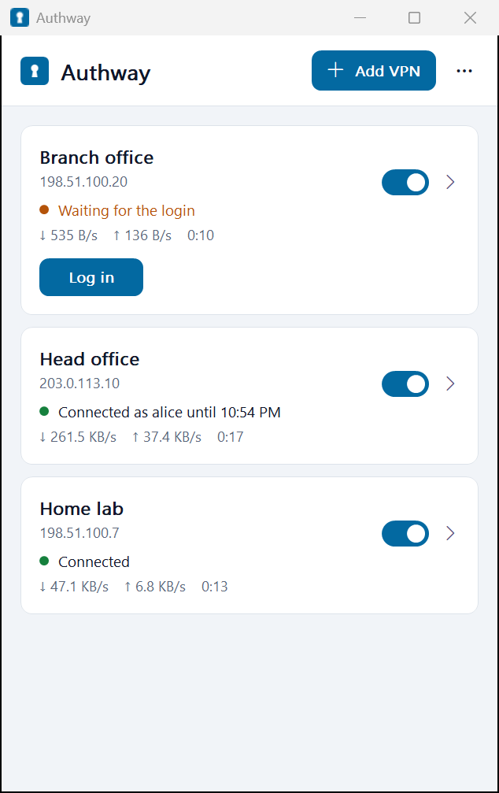
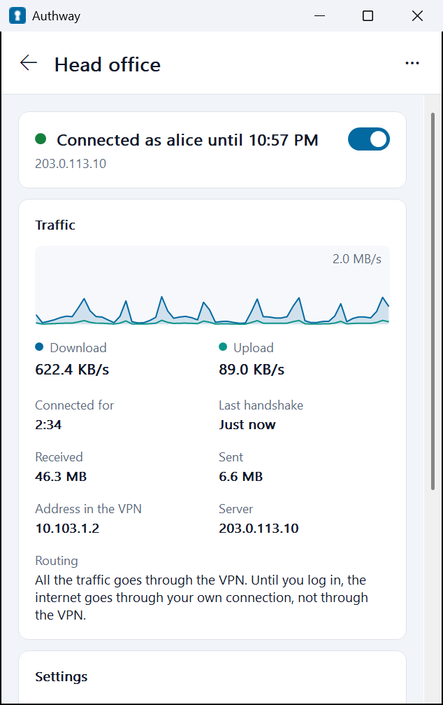
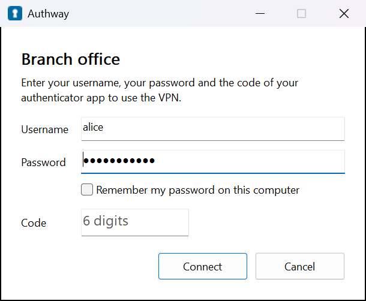

# Authway

A WireGuard VPN client for Windows 10 and 11, and macOS 11 or later ([below](#macos)), in one app: it connects the
tunnel and, for the servers that require it, logs in with username, password and the code of an authenticator app,
then keeps watching the session. It works
with the WireGuard servers of a NethSecurity firewall that use the login of
[ns-wgauth](https://github.com/phatdo1819/nethsecurity/tree/ci-wgauth/packages/ns-wgauth), and with any other
WireGuard server, without a login.

> [!WARNING]
> **Authway is a proof of concept**, not a finished product: it was made to try the login of ns-wgauth from a
> client that logs in by itself. **It was written by an AI** (Claude, by Anthropic), directed and tested by one
> person. No security expert has reviewed it, it hasn't been tested against a real NethSecurity server yet, and the
> macOS version has never run on a Mac. A VPN client handles your traffic and your passwords: read the code before
> you trust it, don't use it in production, and use it at your own risk.

| The VPNs | The page of a VPN | The login |
| --- | --- | --- |
|  |  |  |

Authway on Windows, with made-up names and documentation addresses. There's no picture of the macOS version: it
hasn't run on a Mac yet.

To set up the firewall side and test both together, follow
[WGAUTH-TESTING.md](https://github.com/phatdo1819/nethsecurity/blob/ci-wgauth/WGAUTH-TESTING.md) on the
`ci-wgauth` branch of the NethSecurity fork: steps 1–7 for the login, step 8 for the fallback addresses, step 9
for device binding.

All the names of the app are in [src/product.rs](src/product.rs), and the name of the exe is in
[Cargo.toml](Cargo.toml): to rename it, change them there.

## For the users

1. Open `authway-<version>-x64.msi`, or `-arm64.msi` on a Windows on ARM computer, and click **Next**,
   **Install**. Windows asks for the permission of an administrator, once.
2. The window of the app opens, and at every sign-in. Click **Add VPN** and choose the `.conf` file of the
   administrator, or drop the file on the window. The app saves it protected and offers to delete the file.
3. Turn on the switch of the VPN: the login window asks for username, password and code while the tunnel comes up.
   The sixth digit of the code connects.

**The window** shows a card for each VPN: its switch, the server, its state in words and in color (green connected,
amber waiting for the login or the server, red refused, with what to do), and, while it's on, its speed and for how
long. **Log in** on the card opens the login when the VPN waits for it. A click on the card opens the page of the VPN:
- its state and switch;
- the traffic of the last minutes, as a graph, with the speeds, the bytes, the address of the computer in the VPN,
  the server and the routing: all the traffic, or which networks;
- its name, to rename it while it's off;
- the username of the login, and whether the password is saved, with **Forget it**;
- **All details** (below) and **Remove this VPN**.

Closing the window leaves the app running next to the clock, where its icon opens the window again (a click) or
its menu (a right-click), as starting the app from the Start menu does. The menu is short: **Open Authway**, a line
for each VPN, ticked while it's on, with its state (a click turns it on or off, or opens the login it waits for),
**Add a VPN from its file...** and **Quit**; with more than eight VPNs, the ones that are on stay there and all of them
are under **All the VPNs**. **⋯** in the window has **Add a VPN from its file...**, the logs, **Open the window at
sign-in** (on by default) and **Quit**. The window follows the size of
the texts and the scale of each display, Tab, Space and Enter work in it, and high contrast gives it the colors of
the system.

When the server requires device binding, the first login enrolls this computer: the window says so. The VPN then
works only on this computer, even for someone who has the file and the password. On a new computer, or after
removing the VPN from the app, ask the administrator to allow a new device.

When the session ends on the firewall (it expired, or the computer changed network), the window opens again with the
username and the saved password: only the code is needed. **Cancel** or **Disconnect** turns the tunnel off; the
app logs out first. Quitting the app turns the tunnels off.

**Before the login**, a VPN with a login carries only the login page and the private networks of the office, without
its DNS servers: the internet goes through the computer's own connection, as without the VPN. A VPN that waits for
the login, or whose server doesn't answer, never cuts the internet. With the login, a full tunnel takes all the
traffic and the DNS servers of the VPN come on. When the session ends, or the login page doesn't answer for 30
seconds, they go off again until the next login.

**All details**, on the page of a VPN, shows all of it, live: the state, the last handshake and the bytes; the
routing, a full tunnel (all the traffic) or a split tunnel with its networks; the addresses, DNS servers, MTU, listen
port and public key of the computer; the address, port and public key of the server, its fallback addresses and the
one in use, its keepalive, whether it has a preshared key; the login page and the session. Never a private or
preshared key. **Copy all** puts it in the clipboard as text, for the administrator; Ctrl+C copies the rows
selected.

## For the administrators

The MSI package installs for the whole computer, so Intune, Group Policy or any tool that deploys MSI packages
can install it. As administrator, without windows:

```
msiexec /i authway-0.1.0-x64.msi /qn
"C:\Program Files\Authway\authway.exe" --import "C:\path\office.conf" --name "Office"
"C:\Program Files\Authway\authway.exe" --rename "Office" --to "Head office"
"C:\Program Files\Authway\authway.exe" --remove "Office"
msiexec /x authway-0.1.0-x64.msi /qn
```

- **Install**: the app starts at once for every user signed in, and at every sign-in after, with its window unless
  the user turned that off.
- **Rename**: only while the VPN is off. Its device key and the saved logins stay (they belong to the VPN and to
  its login page, not to its name).
- **Update**: install the new package over the old one: it replaces it, even at the same version. The VPNs are kept;
  the app of each user logs out, turns its tunnels off and quits, then starts again.
- **Remove**: from **Settings > Apps**, or `msiexec /x`. It takes away the service, the VPNs with their device keys,
  the logs and the driver, and the settings and passwords of the user who removes it. Other users' saved passwords
  stay in their Credential Manager.
- **Device binding** (`device_binding` of a NethSecurity WireGuard server): the first login of each VPN enrolls this
  computer, then only it can log in. An update keeps the keys; removing a VPN, or the app, deletes them, and the next
  login needs a new enrollment, allowed on the firewall (**Allow a new device** in the menu of the peer). The
  administrator of the firewall sees the computer name of each enrolled device.
- The package is for x64 or ARM64 Windows 10 version 2004 or later, or Windows 11: it refuses the wrong computer.
  The folder is always `C:\Program Files\Authway`.

**The login with the VPN.** `--import` can also save the username and password of the login page, as OpenVPN
Connect does, so the login window is already filled in the first time (the user still clicks **Connect**, and types
the code when the server asks for one):

```
"C:\Program Files\Authway\authway.exe" --import "C:\path\office.conf" --name "Office" --username "alice" --password "Secret,1234"
```

- `--username=alice` and `--password=...` work too. `--username` alone saves only the username.
- The login is saved in the Credential Manager of **the user who runs the command**, for the login page of the
  file (its `# Login =` line; a file without one is refused), as **Remember my password** saves it. So run it as
  that user, not as SYSTEM, which is refused: when the user isn't allowed to add VPNs, the command asks for an
  administrator for the VPN only, and the login stays with the user. For a deployment tool that runs scripts as the
  user, install with `ALLOWUSERIMPORT=1`, below, so no permission is asked.
- With the policy `RememberPassword` = 0 the command refuses `--password`.
- A password on a command line can end up in the history of the shell, in the logs of the deployment tool, or in
  the process auditing of Windows when it's on: prefer having users type it once and check **Remember my
  password**, and change the password after a deployment that might have logged it.

**Who can add, rename and remove VPNs.** By default only an administrator: a VPN can route all the traffic of the computer
and change its DNS, so a user who isn't one sees the permission of Windows when adding or removing a VPN. Any user
can connect and disconnect the VPNs that are there; no group membership is needed. To let every user add and remove
them without that permission:

- check **Every user of this computer** on the page *Who can add VPNs* of the setup, or install with
  `msiexec /i authway-0.1.0-x64.msi /qn ALLOWUSERIMPORT=1`. An update keeps the choice; `ALLOWUSERIMPORT=0`
  takes it back. The setup saves it as `AllowUserImport` = 1 in `HKLM\SOFTWARE\Authway`.
- or the policy `AllowUserImport` = 1, below: it applies at once, and the policy, 0 or 1, wins over the setup.

Policies, as DWORD values in `HKLM\SOFTWARE\Policies\Authway`:

| Value | Effect |
|---|---|
| `RememberPassword` = 0 | the app never saves the passwords, only the usernames |
| `AllowUserImport` = 1 | the users who aren't administrators can add and remove VPNs, without asking for permission |
| `AllowUserImport` = 0 | only the administrators can, whatever the setup chose |

```
reg add "HKLM\SOFTWARE\Policies\Authway" /v AllowUserImport /t REG_DWORD /d 1 /f
```

## How it works

```
 the user                                   SYSTEM
┌──────────────────────┐   named pipe   ┌────────────────────────┐  wireguard.dll   ┌─────────────┐
│ authway.exe          │◄──────────────►│ authway.exe            │◄────────────────►│ WireGuardNT │
│ window, icon, login  │  JSON, a line  │ --service              │  adapters, keys  │ (driver)    │
└──────────┬───────────┘                └────────────────────────┘                  └─────────────┘
           │ HTTP through the tunnel: /api/status, /api/login, /api/logout of ns-wgauth
           ▼
     the login page of the firewall, e.g. http://10.103.1.1:8181/
```

- **One exe, two roles.** The service (`--service`, LocalSystem, started with Windows) owns the tunnels; the app
  of each user talks to it through the pipe `\\.\pipe\Authway`. The users can start the service, not stop it.
- **The setup** is the MSI package of [installer/package.wxs](installer/package.wxs): Windows Installer
  installs the files, the service with its rights and its restarts, the start at the sign-in and the Start menu
  entry. The exe does the rest, with `--msi-...` options: the apps quit before the service stops, they start again
  after the setup, and the data goes when the app is removed, not updated ([src/setup.rs](src/setup.rs)).
- **The tunnels** are WireGuardNT adapters, made by the official `wireguard.dll` of WireGuard LLC, shipped next to
  the exe as it is downloaded ([tools/fetch-wireguard.ps1](tools/fetch-wireguard.ps1) checks its hash and its
  signature). The service sets the addresses, the routes of `AllowedIPs` (metric 0), the MTU (the one of the
  configuration, or of the network to the server less 80) and the DNS servers, in two steps when there's a login
  (below). A tunnel goes off when the user who turned it on signs out, and when the service stops.
- **Two steps with a login** (`Steps` in [src/manager.rs](src/manager.rs)): when the configuration has a `# Login =`
  line, the service turns the tunnel on with the routes of its private networks (10.0.0.0/8, 172.16.0.0/12,
  192.168.0.0/16, 100.64.0.0/10, the link-local ones, fc00::/7) and a route to the login page alone, without the DNS
  servers. The other routes wait: `0.0.0.0/0` and `::/0` of a full tunnel, or a public network. Once logged in, the
  app tells the service (`logged_in` on the pipe), which adds them with the DNS servers. When the status says the
  session ended, or the login page didn't answer for 30 seconds, the app tells it again and the service takes them
  back. Only the routes and the DNS of the computer change, never the configuration of WireGuard: the firewall still
  lets only the login page through before the login. A split tunnel keeps all its routes; only its DNS servers wait,
  which the firewall would answer with the address of the login page before the login. A tunnel without the line,
  a page found by the app included, gets everything at once.
- **Fallback addresses**: the firewall writes the other addresses of a server, a second internet line for example,
  in a `# Fallback = host:port, ...` line after `Endpoint` (on NethSecurity, the *Fallback endpoints* of the server;
  by hand, a fallback without a port takes the one of `Endpoint`). The service reads the counters of the driver every
  second ([src/failover.rs](src/failover.rs)). When this computer keeps sending and nothing comes back for 20
  seconds, it gives the driver the next address, in place. A keepalive is the only message that WireGuard never
  answers, so a quiet tunnel doesn't move. The tunnel stays on, with its routes, its DNS and its login session (the
  public IP of the computer doesn't change). It goes around the list while none answers. The one that answers stays,
  and the next connection starts with `Endpoint` again. A name is looked up again at each change, for 5 seconds at
  most, else its last address is used, so an `Endpoint` alone with a name follows a dynamic DNS too. The other
  WireGuard apps ignore the line.
- **The configurations** are in `HKLM\SOFTWARE\Authway\Tunnels`, encrypted by DPAPI for SYSTEM: the users can't
  read the private keys back. `PreUp`, `PostUp` and the other scripts of wg-quick never run. For **Details...** the
  service gives the app the rest of the configuration and the counters of the driver, and the public key of the
  computer, which it works out from the private one ([src/x25519.rs](src/x25519.rs), checked with the vectors of
  RFC 7748).
- **The login**: the page is the `# Login = ...` line that the firewall writes in the configuration; without it the
  app looks for the page on the first address of the network of the tunnel, port 8181, then through the redirect of
  port 80. The app asks `/api/status` every 20 seconds while logged in, every second while connecting. The password
  goes only through the tunnel:
  - the login page is always an address of the routes of the tunnel (`AllowedIPs`): the service refuses a
    `# Login` line out of them, the app never looks for the page out of them nor follows a redirect out of them, and
    it forgets a page found on an earlier connection once a new configuration leaves it out;
  - the requests go out only through the network adapter of the tunnel, whatever the routes of the computer say
    (`IP_UNICAST_IF`, with the index the service gives): a more specific route of the local network, as a DHCP
    server can push with option 121 ("TunnelVision", CVE-2024-3661), can't take them. A connection that comes from
    an address that isn't one of the adapter is closed before anything is sent.
- **Device binding**: a server can accept the login only from the device enrolled for the configuration
  (`device_binding` of ns-wgauth). The status of the login page then gives a challenge; the app asks the service to
  sign it, with the address of the computer in the VPN, the keys of both sides and the user name, and sends the
  signature with the login ([src/device.rs](src/device.rs)). The service keeps one ECDSA P-256 key for each tunnel,
  made at the first such login: on Windows in the Microsoft Software Key Storage Provider, a key of the computer
  that can't be exported and only SYSTEM and the administrators can use ([src/devkey.rs](src/devkey.rs)); on macOS
  in a file readable by root only. The first login enrolls the key; then a copy of the configuration, even with the
  password, doesn't work on another computer. When the server asks for the machine ID too, the service adds an
  HMAC of the hardware ID of the computer (SMBIOS UUID, else `MachineGuid`; `IOPlatformUUID` on macOS), keyed with
  the public key of the server, so the server never sees the ID. Removing the VPN removes its key: added again, it
  needs a new enrollment, which the administrator allows.
- **The passwords** are in the Credential Manager of the user (`Authway/http://10.103.1.1:8181`), on this
  computer only, if the user checked "Remember my password".
- **The pipe** lets the signed-in users read and write, not create another instance of it; the app checks that the
  process at the other end is the service before talking. The service checks the groups of the caller for the
  administrator rights.

The logs, without passwords, codes or keys: `%LOCALAPPDATA%\Authway\client.log` for the app,
`C:\Program Files\Authway\log\service.log` for the service and the driver. Both are under **⋯ > Logs** in the
window.

## Build

Rust stable with the MSVC toolchain (Visual Studio or its Build Tools, with the Windows SDK), the x64 and ARM64
targets, and [WiX Toolset 3.14](https://github.com/wixtoolset/wix3/releases) for `candle` and `light`:

```
rustup target add x86_64-pc-windows-msvc aarch64-pc-windows-msvc
powershell -File tools\fetch-wireguard.ps1     # wireguard.dll for x64 and ARM64, checked
powershell -File tools\dist.ps1                # dist\authway-<version>-x64.msi and -arm64.msi
```

`dist.ps1` finds WiX through `%WIX%`, set by its setup, or `-Wix <its bin folder>`. It passes the names of
`src\product.rs` and the version of `Cargo.toml` to the package: change them there, never in the `.wxs`. Keep
`UPGRADE_CODE` forever, or a new version doesn't replace the installed one.

`tools\make-icons.cmd` draws the icons of `assets\` and the pictures of the setup again, with the C# compiler of
Windows.

## Tests

```
cargo test --features testing
```

The `testing` feature makes a build for the tests only: the service runs as the user (`--service-console`) with
fake tunnels, its pipe, its keys in `HKCU\Software\Authway test` and its credentials have other names, so it never
touches an installed app. The end-to-end test drove that build against the real code of the ns-wgauth daemon: import,
login with a wrong password then the right one, the session ended by the server, the saved password, cancel, quit
with logout, removal, and a saved login page out of the routes, dropped.

The window was driven the same way, through its buttons, against that build and the same daemon code: the empty
list, two VPNs added from the command line, the page of one, its switch, the card of the other switched on, the
speeds, a rename once off (the registry key follows, the page and the card too), a VPN with a login (the saved
username and password on its page, **Log in** on the card and the page while the login waits, a new username, the
password forgotten), the banner when the service stops, closing it (the app stays) and a second start that shows it
again. The unit tests check the cards (state, tone, what to do, routing), the speeds made from the counters and the
renames the service refuses.

The two steps of a VPN with a login were driven the same way, with a full tunnel: its routes to the internet wait
for the login, come on with it, go when the server ends the session, come back with the next login and go when the
server stops answering, after 30 seconds without an answer (in the log of the service: the fake tunnels change no
route). The unit tests check which routes wait, for full and split tunnels, and when the app asks for them.

The way out of the login: the unit tests check that discovery never goes out of the routes, the redirect included,
and that nothing is sent through another network adapter. On the real driver, two WireGuardNT adapters on 127.0.0.1
played the tunnel and a local network that pushes a more specific route to the login page: a plain connection went
out through the local network, the ones of the login of the app through the tunnel, as the counters of the driver
showed.

The fallback addresses: the unit tests replay the counters second by second (an answer, silence, keepalives only,
names that can't be found). In the test build a fake server answers at any port but 9. In the run of that build,
the Endpoint and a first fallback on port 9 were each left after 21 seconds, and a second fallback, a name, was kept.
On the real driver, two WireGuardNT adapters on 127.0.0.1 were used, the Endpoint on a port where nothing listens:
- the switch came after 21 seconds, and the handshake at the next retry of the driver, 5 seconds later;
- the tunnel stayed there for 2 minutes of unanswered keepalives, then the rekey.

Device binding: the unit tests check SHA-256 and HMAC-SHA256 with the published vectors, the DER of the signatures,
the message, the SMBIOS UUID (byte order, placeholders) and a real key of the Microsoft Software Key Storage
Provider, whose signature `openssl dgst -verify` accepts, as the firewall does. A proof made by `device::prove` was
also accepted by the `verify_device` of the firewall, and refused with another user, address or server. Not tested
yet: against a real firewall, and the key of macOS.

The MSI package for ARM64 was tested as administrator on Windows 11: the x64 one refused, the install, the rights
and restarts of the service, two tunnels through the installed `wireguard.dll`, the steps for the apps as SYSTEM, an
update that keeps the VPNs and restarts the app, and a removal that leaves nothing, the driver included.

## macOS

The same app for macOS 11 or later, Apple silicon and Intel in one package: the same window (the cards, the page of
each VPN with its graph, its name and its login, the drop of a `.conf`), the same short menu, login window, details,
fallback addresses and rules for the password, from the same code ([src/client](src/client),
[src/manager.rs](src/manager.rs)); what differs is in [src/macos](src/macos).

> [!IMPORTANT]
> The macOS version is written and compiles for both processors, but it **hasn't run on a Mac yet**: expect bugs
> on the first runs, and keep a way back to your usual network (`sudo …/uninstall.sh`).

**For the users.** Open `authway-<version>-macos.pkg` and click **Continue**, **Install**: macOS asks for the
password of an administrator, once. The window of the app opens, and at every login, as on Windows; it follows the
light and dark appearance, and Esc goes back from the page of a VPN. Closing it leaves the app in the menu bar, where
its icon has the short menu, **Open Authway** first. The app is in the Dock and in Cmd+Tab only while the window is
open; Cmd+Q quits it. Adding a VPN works as on Windows, and macOS asks for an administrator when the user isn't
allowed. The notices are in the Notification Center: macOS asks once whether the app can show them.

**For the administrators.**

```
sudo installer -pkg authway-0.1.0-macos.pkg -target /
sudo /Applications/Authway.app/Contents/MacOS/authway --import ~/Downloads/office.conf --name "Office"
sudo /Applications/Authway.app/Contents/MacOS/authway --remove "Office"
sudo "/Library/Application Support/Authway/uninstall.sh"
```

- **With the login**, as on Windows: `--username` and `--password` save it in the keychain of the user who runs the
  command, so run it **without sudo**, as that user: macOS asks for an administrator for the VPN only, when the user
  isn't allowed. As root it's refused. On macOS any user can see the command lines of running programs with `ps`,
  for the moment the command runs.

  ```
  /Applications/Authway.app/Contents/MacOS/authway --import ~/Downloads/office.conf --name "Office" --username "alice" --password "Secret,1234"
  ```

- **Update**: install the new package over the old one. The VPNs are kept; the app of each user logs out, turns its
  tunnels off and quits, then the service and the app of the user at the screen start again.
- **Remove**: `uninstall.sh`, as above (it's also in [installer/macos](installer/macos)). It takes away the app,
  the service, the VPNs, the logs, and the settings and passwords of every user; the saved passwords of a user who
  isn't logged in stay in their locked keychain.
- **Policies**: the same values as on Windows, in `/Library/Preferences/io.github.phatdo1819.authway.plist` or in
  a configuration profile (MDM) for that domain, read again within 15 seconds:

  ```
  sudo defaults write /Library/Preferences/io.github.phatdo1819.authway AllowUserImport -bool true
  sudo defaults write /Library/Preferences/io.github.phatdo1819.authway RememberPassword -bool false
  ```

**How it works on macOS.**

```
 the user                                   root (launchd)
┌──────────────────────┐  Unix socket   ┌────────────────────────┐  control socket  ┌──────────────┐
│ Authway.app          │◄──────────────►│ authway --service      │◄────────────────►│ wireguard-go │
│ window, menu, login  │  JSON, a line  │ /Library/Application   │  /var/run/       │ one per      │
└──────────────────────┘                │ Support/Authway        │  wireguard/      │ tunnel, utun │
                                        └────────────────────────┘                  └──────────────┘
```

- **The service** is a launchd daemon, as root, from a copy of the program in `/Library/Application Support/Authway`,
  which only root can change: an administrator could replace `/Applications/Authway.app` without a password. It
  listens on `/var/run/authway.sock`; the app checks that root owns the socket and answers on it. Only root, or every
  user with `AllowUserImport`, can add and remove VPNs: the app asks macOS for an administrator and runs the same
  `--import` as root.
- **The tunnels** are `wireguard-go`, the WireGuard of WireGuard LLC in user space, as the WireGuard tools of macOS
  use it: one process per tunnel on a free `utun` interface, configured through its control socket, never given the
  keys on its command line. The service sets the addresses and the routes as `wg-quick` does (a default route as two
  halves, the server kept out of the tunnel through the gateway of the network), and the DNS servers on every
  network service, put back when the tunnel goes off, and at the start of the service after a crash. It looks at
  them again when the network changes. A tunnel with a login gets them in the same two steps as on Windows.
- **The session of a tunnel** is the user who turned it on. macOS doesn't tell a service when a user logs out: the
  app lists the tunnels at least every 10 seconds, and the service turns off the tunnels of a user whose app stopped
  asking for 2 minutes.
- **The login** goes only through the tunnel, as on Windows, with `IP_BOUND_IF` in place of `IP_UNICAST_IF`.
- **The configurations** are files of root, `/Library/Application Support/Authway/tunnels/<name>.conf`, readable by
  root only. **The passwords** are in the login keychain of the user, under `Authway/http://10.103.1.1:8181`.
- **The device keys** of device binding are P-256 keys made by the Security framework, in
  `/Library/Application Support/Authway/devices/<name>.key`, readable by root only; the machine ID is the
  `IOPlatformUUID` of the Mac. Not in the Secure Enclave yet.
- **The logs**: `~/Library/Logs/Authway/client.log` for the app, `/Library/Logs/Authway/service.log` for the service
  and `wireguard-go`. **Logs** in the menu opens them in Console.

**Build**, on a Mac with the Command Line Tools of Xcode, Rust and Go 1.23.1 or later:

```
rustup target add aarch64-apple-darwin x86_64-apple-darwin
tools/fetch-wireguard-go.sh      # wireguard-go from its source, checked, for both processors
tools/dist-macos.sh              # dist/authway-<version>-macos.pkg
```

The package is signed ad hoc, which is enough for the Mac that builds it. For other Macs, sign it with the
certificates of an Apple developer account (`SIGN_APP="Developer ID Application: ..."`, `SIGN_PKG="Developer ID
Installer: ..."`) and notarize it, or Gatekeeper refuses the downloaded package. With ad-hoc signatures, macOS can ask
once again for the saved passwords after an update: the keychain knows the app by its signature.

**Tests**: `cargo test --features testing` on a Mac too. The test build runs the service as the user
(`--service-console`, socket `/tmp/authway-test.sock`, data in `~/Library/Application Support/Authway test`) with fake
tunnels; the test of the login on `127.0.0.2` needs `sudo ifconfig lo0 alias 127.0.0.2` first.

## Not done yet

- Tested with a real NethSecurity server: not yet (the real driver only on 127.0.0.1). The two steps of a VPN with
  a login: not on the real driver nor on a Mac yet.
- macOS: never run on a Mac yet, see above, its window neither ([src/macos/ui/home.rs](src/macos/ui/home.rs)).
- No kill switch: when the tunnel is down, the traffic goes out of it; no block of the DNS outside of the tunnel.
- The packages and the programs aren't signed by a known publisher: SmartScreen and Gatekeeper warn when they're
  downloaded.
- No reconnection by itself at the sign-in, no tunnels per user, English only.
- Device binding: software keys only, not in the TPM or the Secure Enclave.
- iOS and Android: not started.

## Licenses

The app is under the MIT license of [LICENSE](LICENSE), installed next to it as `LICENSE.txt`. `wireguard.dll` is under the license of WireGuard LLC in `wireguard-LICENSE.txt`, which allows to ship it unchanged
next to an app that uses its API. `wireguard-go` is under the MIT license, in `wireguard-go-LICENSE.txt` next to it
on macOS. "WireGuard" is a registered trademark of Jason A. Donenfeld: the app doesn't use it in its name.
