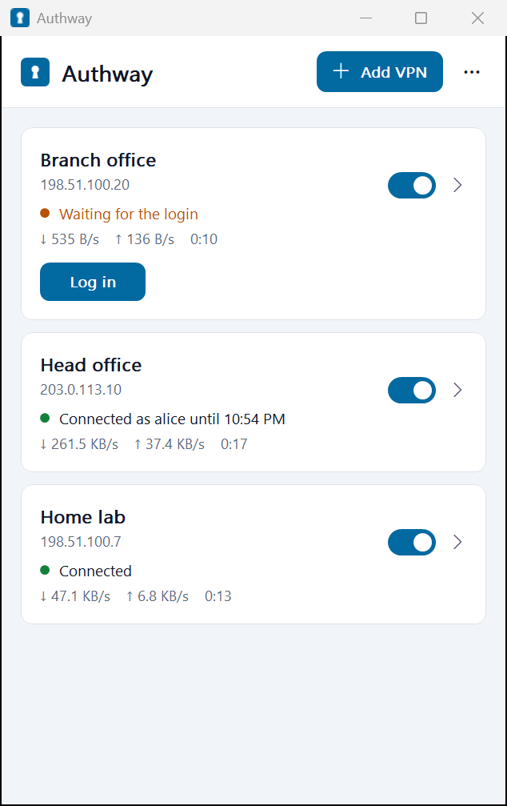
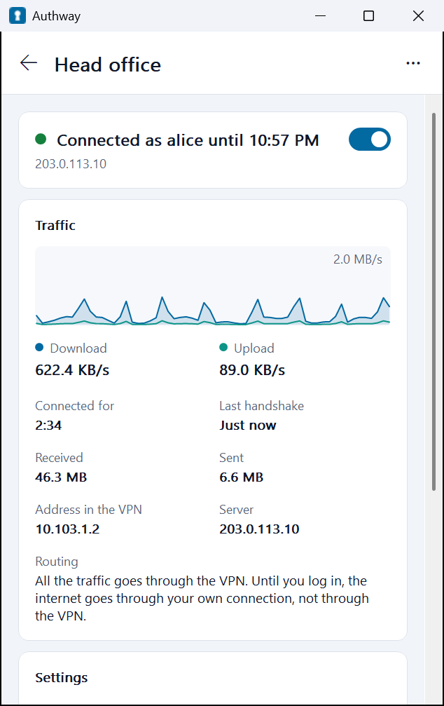
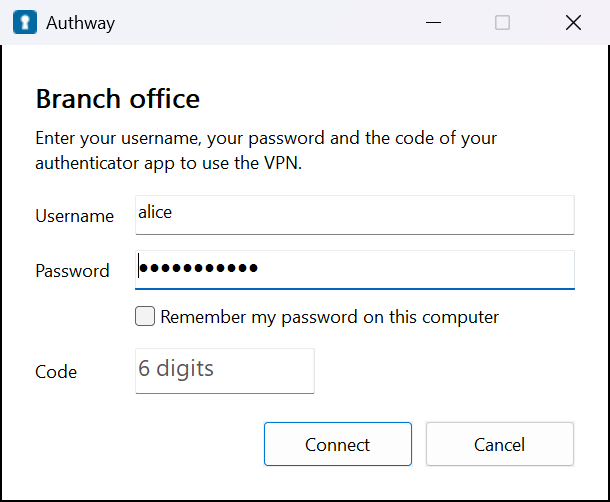

# Authway

A WireGuard VPN client for Windows 10 and 11, and macOS 15 or later, that can log in by itself. When the server
requires it, Authway logs in with a username, a password and an authenticator code, then keeps watching the session.

It's made for NethSecurity firewalls with the WireGuard login of
[ns-wgauth](https://github.com/phatdo1819/nethsecurity/tree/ci-wgauth/packages/ns-wgauth). It also works with any
other WireGuard server, without the login.

> [!WARNING]
> **A proof of concept written by an AI** (Claude, by Anthropic): expect bugs and issues. Please consult your
> security team before using it.

## Why Authway

- **It logs in by itself.** On a server with the login (the *Authentication mode* of [ns-wgauth](https://github.com/phatdo1819/nethsecurity/tree/ci-wgauth/packages/ns-wgauth): a password, or a
  password and an authenticator code), Authway asks for the login when it connects, then keeps watching the session.
- **Device binding.** The first login ties the VPN to this computer and gives it a WireGuard key of its own, so a
  copied `.conf` file is useless anywhere else.
- **No administrator needed to use it.** Any user can connect and disconnect. Users who aren't administrators can
  also add VPNs from a `.conf` file: on macOS by default, on Windows when the administrator allows it (one option in
  the setup, or a policy).
- **Fallback addresses.** When the server doesn't answer, Authway tries its other addresses, a second internet line
  for example, without losing the login session.

| The VPNs | The page of a VPN | The login |
| --- | --- | --- |
|  |  |  |

## For the users

1. Download `authway-<version>-x64-unsigned.msi` from the [releases](https://github.com/phatdo1819/authway/releases)
   (`-arm64-unsigned.msi` on Windows on ARM) and open it. When SmartScreen says *Windows protected your PC*, click
   **More info**, then **Run anyway**.
2. Click **Add VPN** and choose the `.conf` file from your administrator.
3. Turn on the switch of the VPN, and log in when asked.

On a Mac, see [macOS](#macos).

Good to know:

- Until you log in, only the login page and the office's private networks go through the VPN: your internet keeps
  working.
- When the session ends, the login window opens again. With a saved password, only the code is needed.
- With device binding, the VPN works only on the computer that logged in first. On a new computer, or after a
  reinstall, ask your administrator to allow a new device.

Everything the app does: the [user guide](docs/user-guide.md).

## macOS

The same app, for Apple silicon and Intel. It has only run in a macOS virtual machine: expect bugs on a real Mac.

1. Download `authway-<version>-macos-unsigned.pkg` from the [releases](https://github.com/phatdo1819/authway/releases)
   and open it. When macOS says it can't check the package, open **System Settings → Privacy & Security** and click
   **Open Anyway**.
2. Then as on Windows. The app is in the menu bar.

To remove it: `sudo "/Library/Application Support/Authway/uninstall.sh"`.

## For the administrators

- Deploy the MSI with Intune, Group Policy or any MSI tool, and the macOS package with `installer`.
- Add VPNs without windows with `authway --import`, and fill in the login for the user.
- Choose with policies who can add VPNs and whether passwords are saved.
- Read the pros and cons of device binding before turning it on.

All of it is in the [administrator guide](docs/administrators.md). For the firewall side, follow
[WGAUTH-TESTING.md](https://github.com/phatdo1819/nethsecurity/blob/ci-wgauth/WGAUTH-TESTING.md).

## Documentation

| | |
| --- | --- |
| [User guide](docs/user-guide.md) | The window, the menu, the login, what to expect |
| [Administrator guide](docs/administrators.md) | Deployment, the login, policies, device binding, logs |
| [How it works](docs/how-it-works.md) | The service, the tunnels, the login and its security |
| [Building](docs/building.md) | The Windows and macOS packages, the tests |
| [What was tested](docs/testing.md) | The test machines, and what each test checked |

## Build

See [Building](docs/building.md).

## Limitations

- Tested in virtual machines only: not on physical computers, nor with a firewall in production.
- The login and device binding need the ns-wgauth firewall of the NethSecurity fork, with a local users database.
- No kill switch: when the tunnel is down, the traffic goes out without it. DNS outside the tunnel isn't blocked.
- The packages aren't signed by a known publisher, so Windows and macOS warn before installing them.
- No automatic updates: install each new version by hand or with your deployment tool.
- The VPNs don't reconnect by themselves at sign-in.
- The VPNs belong to the computer, not to a user: every user of the computer can connect them. The saved passwords
  stay with each user, and a VPN that is on stays the one of the user who connected it: the others can't log in on
  it, nor disconnect it unless they can add and remove VPNs.
- English only.
- Device binding uses software keys, not the TPM or the Secure Enclave.
- No iOS or Android app.

## Contributing

Feel free to fork Authway, or to contribute: issues and pull requests are welcome. To build it, see
[Building](docs/building.md). Authway is under the MIT license, so you can reuse it in your own projects too.

## Licenses

Authway is under the MIT license ([LICENSE](LICENSE)). `wireguard.dll` (Windows) is under the license of WireGuard
LLC, which allows shipping it unchanged next to an app that uses its API; `wireguard-go` (macOS) is under the MIT
license. Both licenses are installed next to the app. "WireGuard" is a registered trademark of Jason A. Donenfeld:
the app doesn't use it in its name.
